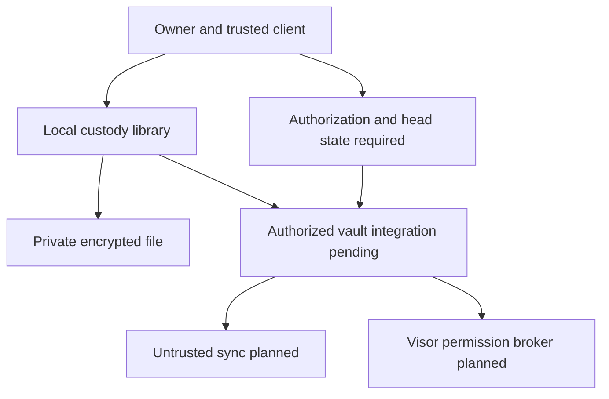

# Secret store threat model

## Executive summary

#155 now has canonical signing transcripts and an initial passphrase-sealed Unix
custody backend. These components are library building blocks, not an activated
cross-client vault. The highest-risk integration mistakes are releasing plaintext
on unlock without current authorization, trusting rollback state from a sync
peer, and treating device revocation as revocation of copied account keys. A
compromised sync server must have neither plaintext nor authority. Independent
security review remains required before GA.

## Scope and assumptions

User-confirmed choices: 1 MiB item payload, passphrase-sealed file first; hardware
adapters follow separately. Metadata has a separate 16 KiB cap. Runtime scope is
`crates/sociacl-encdisc/src/{vault_local,vault_file,vault_format,wrap,present,rotation,store_write,account,recovery}.rs`
and matching TypeScript contract transcripts. No secret-store CLI, network sync,
phone client or Visor integration is claimed by this implementation.

The kernel, running process, dependencies and private-directory parents are
trusted. The adversary may steal a locked device, control a sync peer or network,
retain previously authorized material, or supply stale/malformed ciphertext.
Root/admin or malicious same-user code on an unlocked device, malicious builds,
and retrieval of previously copied plaintext are outside the protection claim.
Availability against deletion is not guaranteed. Policy floors and time must come
from independent trusted state; the local adapter does not provide that ledger.

## System model

Rust library entry points are `seal_local_vault_item`, `open_local_vault_item` and
`LocalVaultFileStore::{open,read,write}`. Encryption uses random per-version DEKs,
Argon2id and XChaCha20-Poly1305 (`vault_local.rs`); no network I/O occurs there.
Canonical version and audit transcripts exist in Rust and TypeScript
(`vault_format.rs`, `typescript/contract/vault-format.ts`). Transcript construction
is not signature verification. Existing `check_presented_grant`,
`rotate_on_revoke` and the trusted-head write machinery provide integration
building blocks, but the custody functions do not call them.

Boundaries: caller plaintext/password enters custody and remains caller-owned;
authenticated ciphertext leaves custody for a filesystem that may later be
stolen or rolled back; the caller's independent expected head crosses into the
file adapter as trusted input. Future sync bytes are untrusted at every read.
Successful unwrap cannot cross the authorization or use/sign broker boundaries.
Build and test execution is separate: ordinary encryption tests run in PR CI;
filesystem/browser/service lifecycle tests run in central scheduled CI through
`scripts/nightly-integration.mjs`. Test fixtures are not deployment evidence.

## Assets

| Asset | Required property | Evidence anchor |
| --- | --- | --- |
| Item payload and private metadata | Confidentiality, integrity, bounded size | `vault_local.rs::seal_local_vault_item` |
| SEA account identity and history | Authentic ownership independent of login provider | `account.rs`; `vault_format.rs` |
| DEKs and local wrapping key | Freshness, restricted custody, destruction of internal copies | `vault_local.rs::derive`; `wrap.rs` |
| Epoch, version and audit heads | Authenticity and rollback resistance | `present.rs`; `store_write.rs`; `vault_format.rs` |
| Device and grantee authorization | Least privilege and revocation for future access | `rotation.rs`; `account.rs::DeviceEnrollment` |
| Encrypted local state | Atomic replacement and explicit conflicts | `vault_file.rs::LocalVaultFileStore` |

## Attacker model

A sync operator can replay, fork, withhold, delete or replace all transported bytes
and observe sizes/timing; encryption must not turn it into an identity authority.
A thief with locked files can guess passwords offline and inspect headers. A
revoked grantee retains old plaintext and keys and can replay old grants. A remote
sender can supply invalid bounded objects through future consumers; there is no
public vault listener in the present library. Same-user process compromise can
read memory and bypass local brokering and is explicitly outside this model.

## Entry points

| Entry | Trust and existing checks | Residual boundary |
| --- | --- | --- |
| `LocalVaultEnvelope::from_bytes` | Untrusted bytes; magic and maximum/minimum size | Structural admission only; authentication occurs on open |
| `open_local_vault_item` | Password and expected owner; bounded KDF, AEAD, owner/length checks | No Check, epoch freshness or signed-version admission |
| `seal_local_vault_item` | Caller plaintext, metadata, owner, optional item ID | Caller must authorize the operation and protect its own copies |
| `LocalVaultFileStore::read/write` | File bytes untrusted; private mode, no-follow, expected head/CAS | Independent durable head ledger required |
| `vault_format` transcript builders | Bounded canonical fields, explicit parents and audit predecessor | Encoding does not authenticate DAG, signer or audit completeness |
| Future sync and client adapters | Not implemented by these modules | Must preserve all authorization and freshness gates |

## Top abuse paths

1. Steal a locked file, make offline password guesses, recover its DEK and secrets.
   Fixed Argon2 cost and strength admission raise cost; hardware custody remains stronger.
2. Replay a valid old ciphertext and its old head together. AEAD succeeds; only an
   independently retained trusted floor detects rollback.
3. Present a valid wrap after revocation and exploit a consumer that releases
   plaintext on unlock. Check and fresh epoch proof must precede authorized release.
4. Replace a filename with a symlink, hard link or permissive file to redirect
   access. The adapter rejects those states; trusted-parent and OS assumptions remain.
5. Race two writes or lose the successful write response. Atomic CAS and exact
   ciphertext retry prevent silent overwrite; crash-lock recovery remains explicit.
6. Publish raw `WrappedKey` objects or signed manifests on sync and expose target,
   group, identity and version relationships. Encrypt manifests and capability routing.
7. Revoke a device wrap while its copied account signing key remains usable.
   Account-key rotation and affected epoch rotation are separate required operations.
8. Omit read/use audit events or serve an older valid chain. A signature proves
   authenticity of recorded events, not completeness or newest-head availability.

## Threat register

| ID | Source | Prerequisites | Action | Impact | Assets | Existing controls | Gaps | Mitigation | Detection | Likelihood | Severity | Priority |
| --- | --- | --- | --- | --- | --- | --- | --- | --- | --- | --- | --- | --- |
| V1 | Locked-device thief | Ciphertext copy and guessable password | Offline guessing | Secret disclosure | Payload, DEK | Fixed Argon2id; strength check on seal | No hardware custody | Strong password and later device adapters | No reliable offline-guess detection | Medium | High | High |
| V2 | Sync peer | Client trusts peer-provided floor | Replay file and head | Rollback, stale access | Epoch/version heads | `read` requires exact external head | Durable protected ledger pending | Authenticate and retain floors independently; refuse missing state | Head mismatch and fork records | High for naive integration | High | Critical integration gate |
| V3 | Revoked reader | Consumer treats unwrap as authority | Use stale wrap/grant | Future unauthorized access | Payload, policy | Existing Check and epoch APIs | Not composed into vault | Verify fresh authorization before release/use; bounded offline lease | Structured denial without secret labels | Medium | High | Critical integration gate |
| V4 | Filesystem manipulator | Can replace stored files | Redirect, corrupt or race write | Loss/disclosure | Local state | 0700/0600; no-follow; link checks; fsync/CAS | Parent/same-user attacker excluded; stale lock blocks writes | Trusted parents; explicit recovery and backups | Generic storage failure; operator diagnosis | Medium | Medium | Medium |
| V5 | Curious sync peer | Client uploads raw manifests/wraps | Correlate identities | Metadata disclosure | Names and relationships | Local metadata encrypted | Confidential network routing pending | Encrypt signed manifests and capability-address wraps | Wire-format privacy fixtures | High if raw wraps reused | High | High |
| V6 | Lost-device holder | Copied SEA account key | Sign after device-wrap revocation | Account compromise | Identity and items | Rotation primitives | Device-only revocation insufficient | Rotate account and affected epochs; new recovery passphrase | Authenticated history and retired-key refusal | Medium | High | High |
| V7 | Malicious client or peer | Can omit or roll back log events | Hide read/use | Audit gaps | Audit evidence | Canonical predecessor transcript | Broker enforcement and independent audit head pending | Atomic authorized operation/log policy and independent floors | Chain mismatch, missing continuity | Medium | Medium | High |
| V8 | Input supplier | Future exposed consumer allows repeated opens | Exhaust memory/CPU | Availability loss | Client resources | Envelope cap; fixed KDF cost | No global concurrency/rate policy in library | Caller limits concurrent unlock attempts; no attacker-selected KDF parameters | Aggregate bounded counters | Medium | Medium | Medium |

## Criticality calibration

Critical integration gates are blockers before exposing an authorized vault API,
not assertions that an existing public endpoint is exploitable. Identity, epoch
and plaintext-release failures have high impact; local deletion is lower because
availability against a filesystem attacker is not guaranteed. No online rate
limiter can prevent offline password guesses. Secret copying before revocation
cannot be undone. Zeroization reduces retained internal buffers but does not
protect caller copies, process dumps or an unlocked compromised process.

## Focus paths

| Path | Review focus |
| --- | --- |
| `crates/sociacl-encdisc/src/vault_local.rs` | AEAD domains/header binding, KDF bounds, fresh keys/nonces, decrypted length admission |
| `crates/sociacl-encdisc/src/vault_file.rs` | Trusted parents, file identity/modes, CAS/retry/fsync ordering, rollback expectations |
| `crates/sociacl-encdisc/src/vault_format.rs` | Canonical signatures, confidential manifest, parent and audit-head admission |
| `crates/sociacl-encdisc/src/present.rs` | Check and fresh epoch proof composition |
| `crates/sociacl-encdisc/src/rotation.rs` | Atomic epoch/wrap/version publication and sensitive re-encryption |
| `crates/sociacl-encdisc/src/account.rs` | Enrollment copies, account rotation versus device revocation |
| `crates/sociacl-encdisc/src/wrap.rs` | Wrap possession versus authority, routing metadata leakage |
| `scripts/nightly-integration.mjs` | Scheduled-only lifecycle qualification and cleanup ownership |

## Notes on use and quality

This is a repository-grounded design review, not an independent audit or a claim
of deployed protection. Source and test coverage establish intended contracts;
CI run links establish which checks actually executed. Remaining design work is
confidential cross-client framing/routing, shared cryptographic vectors, durable
head/audit state and consumer authorization composition. Revisit this model when
network sync, a CLI, offline leases, hardware keys or a new consumer is added.

### Authorized-read integration update

`vault_read.rs::read_authorized_local_vault` now connects the current account
signature, independently supplied item/object/head/epoch expectation, actual
ciphertext digest, `check_presented_grant`, and passphrase custody. It rechecks
current time after KDF and commit, so an expiry crossing either boundary yields
no plaintext. The required consumer commit callback must atomically persist
nonce/revision state and compare the independent head; a dishonest or non-durable
callback remains outside the library's guarantees. V2 therefore still requires
a protected head ledger, while V3 now has an executable composition seam.
Remaining release/use/sign brokering and cross-client integration are unchanged.
